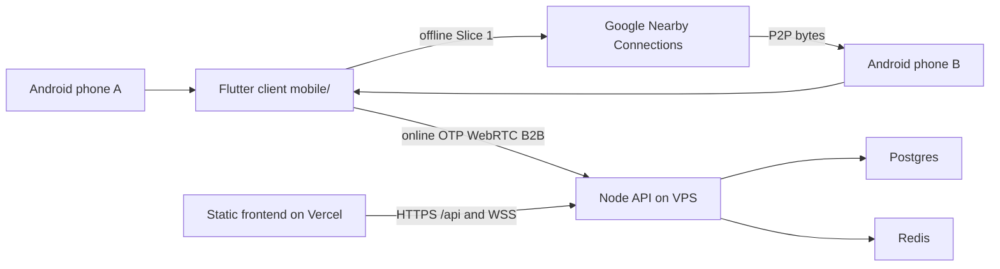
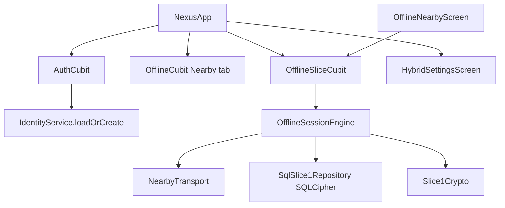
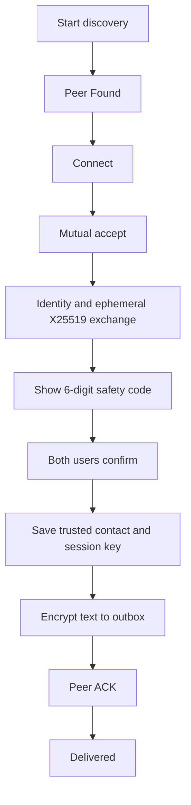
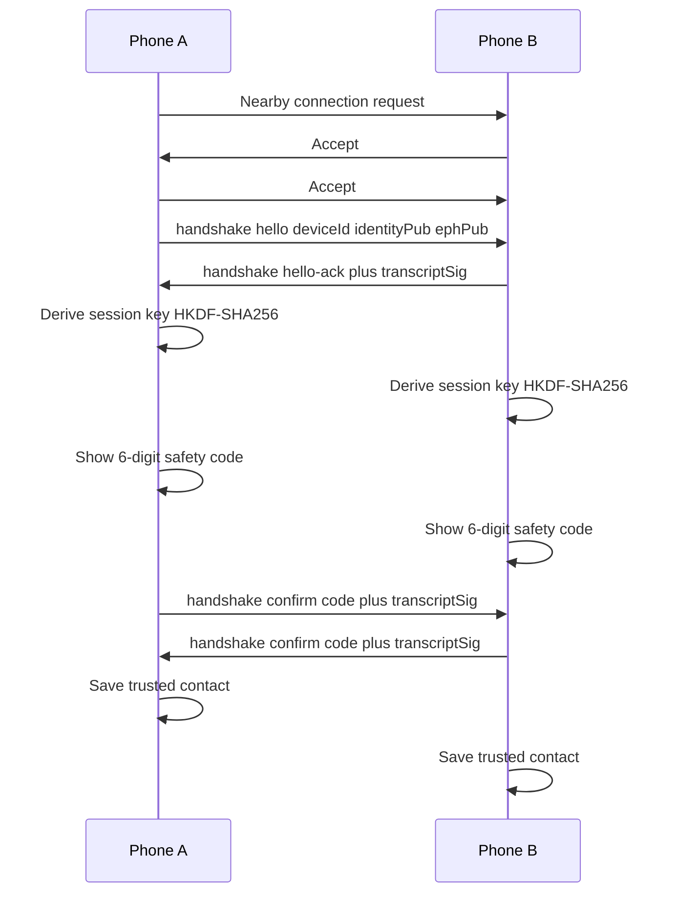
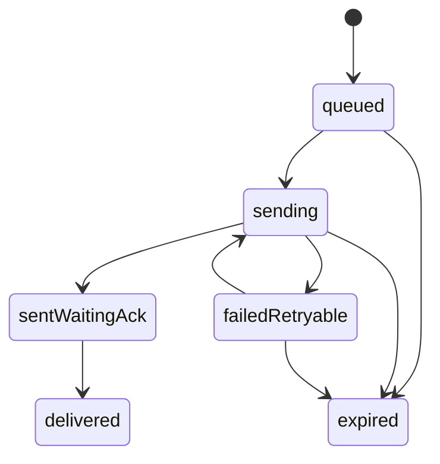
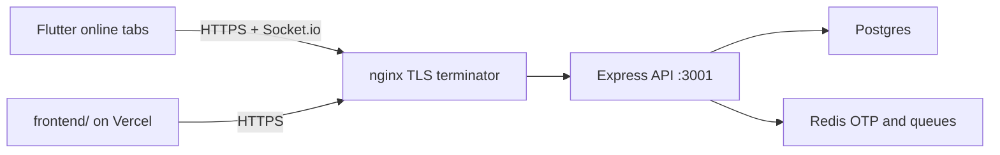

# Architecture design

Nexus Comm / dsaialap is a hybrid E2EE communication product. Online signaling, OTP, and B2B stay on the existing backend. Slice 1 offline nearby chat is local-only on two Android phones and does not use the server after a device identity exists.

This protocol is a Slice 1 prototype, not Signal, and not production-audited.

## System context



| Path | Needs internet | Needs OTP / SIM | Transport |
| --- | --- | --- | --- |
| Offline nearby text (Slice 1) | No | No | Nearby Connections |
| Online chat / WebRTC / OTP | Yes | Yes for account | HTTPS + Socket.io |
| B2B dashboard | Yes | API key | HTTPS `/api/b2b` |

Slice 1 must keep working in airplane mode with Bluetooth on. Wi-Fi may stay on without joining a network if the phone requires it for Nearby.

## Repository layout

```
backend/     Node.js + TypeScript API, Socket.io, Prisma, Redis
mobile/      Flutter client (online tabs + Slice 1 offline module)
frontend/    Static landing + B2B portal (Vercel)
docs/        Architecture, deploy process, threat model, test plan
.github/     APK, backend CI/CD, frontend Vercel workflows
```

Do not put private keys, PATs, keystore passwords, or `.env` values in git.

## Flutter client



Two stacks coexist on purpose:

- Nearby tab uses `mobile/lib/core/` (`DeviceIdentityService`, `OfflineCubit`).
- Slice 1 screen uses `mobile/lib/offline_slice1/` (`IdentityService`, `OfflineSliceCubit`).

OTP login, production API URLs, signing, and licence stay unchanged. Settings may store an optional online account hint without replacing Ed25519 keys.

## Slice 1 offline flow



Rules:

1. Both devices must accept the Nearby connection. One-sided accept does not connect.
2. Both devices must show the same 6-digit safety code.
3. Both users must confirm. One-sided confirm does not auto-trust.
4. Mismatch or reject cancels pairing.
5. Unknown / untrusted peers cannot send or decrypt application text.

## Pairing and crypto



Prototype primitives:

- Long-term identity: Ed25519
- Handshake: ephemeral X25519
- KDF: HKDF-SHA256 info `nexus-slice1-v1`
- Messages: AES-256-GCM, 12-byte nonce, envelope metadata as AAD
- Safety code: first 32 bits of SHA-256(transcript) as a 6-digit number
- Transcript bytes are sorted so both phones hash the same canonical string

Private identity keys live only in `flutter_secure_storage`. SQLCipher holds envelopes, outbox, inbox after AEAD success, trusted contacts, seen ids, and session keys. Private keys are never written to SQL, logs, or git.

## Message reliability



Retry runs on app launch, resume, and peer reconnect. TTL expiry marks `expired`. Device-reboot WorkManager retry is a later slice.

Wrong recipient, bad signature, tampered ciphertext, replayed message ids, and unknown peers are dropped.

## Online production path (unchanged)



Online features (OTP, JWT, Socket.io signaling, B2B `/api/b2b`, optional CPaaS) stay on the VPS. Slice 1 does not call `/api/*`.

## Transport choice

`Transport` is implemented by `NearbyTransport`. `TransportManager` uses Nearby first. Slice 1 does not add raw BLE, Wi-Fi Direct, or Wi-Fi Aware. UI shows available / connected / unavailable / error only.

QR pairing is out of Slice 1. A later slice can encode `deviceId + identity public key` in a QR payload, then continue with the same safety-code confirm step.

## Out of Slice 1

- Voice, WebRTC, backend groups, PTT, telecom, QR scanner, WorkManager
- Independent cryptographic review
- Real two-phone acceptance (manual guide in `docs/demo-offline.md`)
