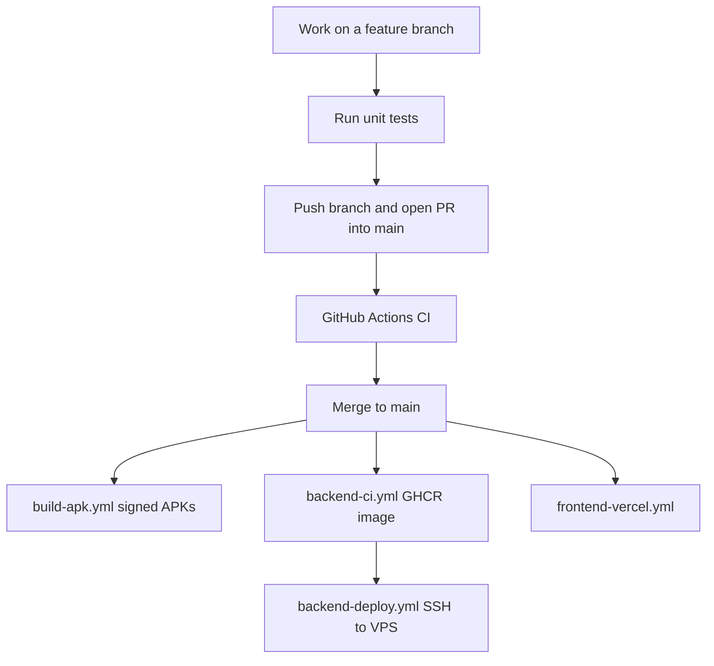
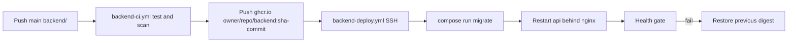

# Deployment process

Use this document as the release checklist. Detailed VPS commands live in `DEPLOY.md`. Do not change backend OTP, production API URLs, signing, or licence as part of Slice 1.



## What deploys where

| Piece | Host | Trigger | Artifact |
| --- | --- | --- | --- |
| Flutter app | GitHub Release | Push `main` or workflow_dispatch `build-apk.yml` | Split-per-ABI release APKs |
| Slice 1 offline chat | Inside the APK only | Same as Flutter | No server deploy |
| Backend API | Google VPS `dsaialap.banglarvoice24news.com` | `backend-ci.yml` then `backend-deploy.yml` | GHCR image digest |
| Static frontend | Vercel | `frontend-vercel.yml` | Preview on PR, production on `main` |

Slice 1 nearby chat does not need the VPS, OTP, SIM, or internet after identity exists. Installing an APK on two phones is enough for the offline path.

## Hard rules

1. Never commit `.env`, keystores, PATs, SSH keys, or keystore passwords.
2. Never put a PAT in a git remote URL.
3. Never deploy `latest`. Backend images are immutable `sha-<commit>` tags resolved to a digest.
4. Never run Prisma migrations inside the API container. The one-shot `migrate` service must finish first.
5. Never change `/api/auth`, `/api/users`, `/api/messages`, Socket.io events, or production `API_BASE_URL` for Slice 1 work.
6. Never mark two-phone Nearby acceptance as passed from unit tests or an emulator.
7. Production SMS is required: Twilio or `SMS_API_URL` / `SMS_API_KEY`. Log OTP fallback is dev/test only.
8. Prisma migrations must be additive and backwards-compatible so VPS rollback can restore the previous image digest.

## 1. Local Slice 1 APK (developer machines)

Use this to test offline nearby on physical Androids. Do not upload debug APKs to GitHub Releases.

```bash
cd mobile
flutter pub get
flutter gen-l10n
flutter analyze --no-fatal-infos
flutter test test/offline_slice1/slice1_crypto_test.dart test/offline_slice1/slice1_session_test.dart test/offline_slice1/slice1_outbox_test.dart
flutter build apk --debug
```

Install `mobile/build/app/outputs/flutter-apk/app-debug.apk` on two phones. Follow `docs/demo-offline.md`.

Release-shaped local build (does not replace CI signing):

```bash
cd mobile
flutter pub get
flutter gen-l10n
flutter build apk --release --split-per-abi --dart-define=API_BASE_URL=https://dsaialap.banglarvoice24news.com
```

Outputs:

- `mobile/build/app/outputs/flutter-apk/app-arm64-v8a-release.apk`
- `mobile/build/app/outputs/flutter-apk/app-armeabi-v7a-release.apk`
- `mobile/build/app/outputs/flutter-apk/app-x86_64-release.apk`

`mobile/build/` is gitignored. Do not commit APKs.

## 2. Git branch and CI gate

```bash
git checkout -b feat/offline-slice-1
```

Push the branch. Open a pull request into `main`. Required checks before merge:

- Mobile: `flutter analyze --no-fatal-infos` and `flutter test` (`.github/workflows/build-apk.yml` job `analyze-test`)
- Backend (only if `backend/` changed): typecheck, jest, npm audit critical, gitleaks, trufflehog, hadolint
- Frontend (only if `frontend/` changed): Vercel preview deploy

Do not force-push shared branches. Do not skip secret scan failures.

## 3. Production APK via GitHub Actions

Workflow: `.github/workflows/build-apk.yml`.

On push to `main`, or Actions -> Build APK and Release -> Run workflow.

GitHub secrets (repo Settings -> Secrets and variables -> Actions):

- `KEYSTORE_BASE64`
- `KEY_ALIAS`
- `KEY_PASSWORD`
- `STORE_PASSWORD`

If `KEYSTORE_BASE64` is empty the job still builds, but the APK is not store-signed. Preferred path is a filled keystore.

One-shot helper from a clean tree (needs `gh` auth):

```bash
VERSION=v1.0.0 ./deploy_and_export.sh
```

Download from:

```text
https://github.com/dulalsarder90-hash/Calling-a-to-z/releases/tag/<tag>
```

Default API baked into CI APKs: `https://dsaialap.banglarvoice24news.com`. Override only through the workflow input `api_base_url`.

## 4. Backend to VPS



### First-time VPS bootstrap

Target: `/opt/dsaialap` on the Google VPS. DNS `dsaialap.banglarvoice24news.com`.

```bash
cd /opt/dsaialap/backend
cp .env.example .env
```

Fill `.env` on the host only. Minimum: `POSTGRES_USER`, `POSTGRES_PASSWORD`, `POSTGRES_DB`, `REDIS_PASSWORD`, `JWT_ACCESS_SECRET`, `JWT_REFRESH_SECRET`, `BACKUP_KEY_PEPPER`, `CORS_ORIGINS`, `PUBLIC_HOST`, SMS credentials, and later `BACKEND_IMAGE` / `BACKEND_MIGRATE_IMAGE`.

GitHub environment `production` secrets for `.github/workflows/backend-deploy.yml`:

- `VPS_SSH_KEY`
- `VPS_KNOWN_HOSTS`
- `VPS_USER`
- `VPS_HOST`
- `VPS_DEPLOY_PATH`
- `GHCR_USER`
- `GHCR_PULL_TOKEN`

Bootstrap once:

```bash
cd /opt/dsaialap/backend
docker compose --env-file .env -f docker-compose.prod.yml pull
docker compose --env-file .env -f docker-compose.prod.yml run --rm migrate
docker compose --env-file .env -f docker-compose.prod.yml up -d --remove-orphans
bash scripts/issue-certs.sh
chmod +x scripts/dsaialap_monitor.sh
```

### Everyday backend release

1. Merge backend changes to `main`.
2. `backend-ci.yml` typechecks, tests, scans, builds `runtime` and `migrate` images, Trivy-fails on CRITICAL, pushes `sha-<git sha>` to GHCR.
3. `backend-deploy.yml` SSHs to the VPS and runs `backend/scripts/deploy-vps.sh`.
4. The script pulls by digest, runs `migrate`, recreates `api`, waits for `/health`, and rolls back the previous digest on failure.

Manual deploy of a known good tag:

```text
Actions -> Backend Deploy (VPS) -> Run workflow -> image_tag = sha-<commit>
```

Do not SSH-tunnel the Agent environment to the VPS. Operators run deploy from GitHub Actions or from the VPS shell.

### After deploy

Cron on the VPS:

```bash
# /etc/cron.d/nexus-backup daily 02:30 UTC
30 2 * * * root cd /opt/dsaialap/backend && docker compose --env-file .env -f docker-compose.prod.yml --profile backup run --rm backup >> /var/log/nexus-backup.log 2>&1
```

```bash
* * * * * /opt/dsaialap/backend/scripts/dsaialap_monitor.sh
```

Lock GCP firewall port 443 to Cloudflare edge IPs. nginx only trusts `CF-Connecting-IP` from Cloudflare ranges.

## 5. Frontend to Vercel

Workflow: `.github/workflows/frontend-vercel.yml`.

Repo secrets: `VERCEL_TOKEN`, `VERCEL_ORG_ID`, `VERCEL_PROJECT_ID`.

Vercel project settings:

- Framework Preset: Other
- Root Directory: `frontend`
- Install / Build: none
- Output Directory: `.`

PRs get a preview URL. `main` deploys production. No frontend secrets belong in git. `frontend/.env.example` documents that no build-time env is required today.

Netlify alternative: publish directory `frontend` via root `netlify.toml`.

## 6. Verify a release

Online API:

```bash
curl -fsS https://dsaialap.banglarvoice24news.com/health
```

APK: install the three ABI APKs from the GitHub Release on matching devices, then smoke OTP login on a networked phone.

Offline Slice 1: two physical Androids, airplane mode, Bluetooth on, `docs/demo-offline.md`. Do not certify Nearby from CI.

## Rollback

- APK: GitHub Release -> previous tag. Users sideload the older APK.
- Backend: re-run Backend Deploy with the previous `sha-<commit>`. This restores `BACKEND_IMAGE` / `BACKEND_MIGRATE_IMAGE`. It cannot undo a destructive migration.
- Frontend: Vercel dashboard -> Instant Rollback to the previous production deployment.

## Related files

- `docs/architecture.md` — system and Slice 1 design
- `DEPLOY.md` — VPS runbook
- `docs/demo-offline.md` — two-phone manual test
- `docs/test-plan.md` — unit and secret inspection
- `docs/threat-model.md` — prototype crypto limits
